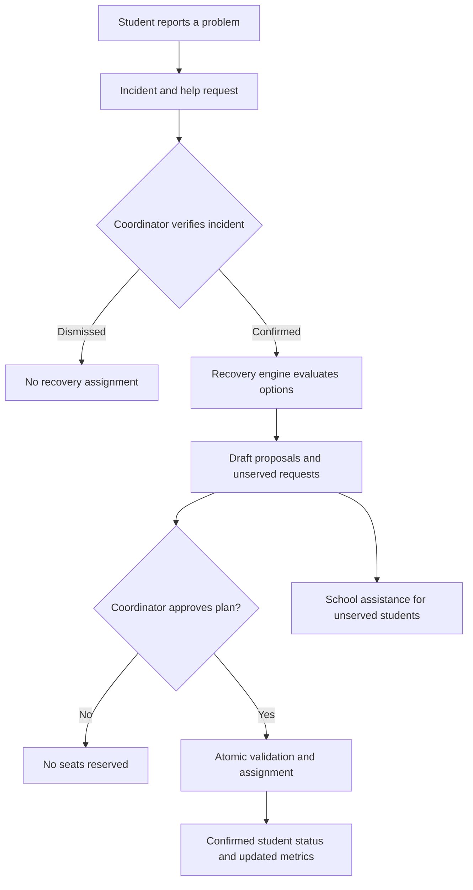
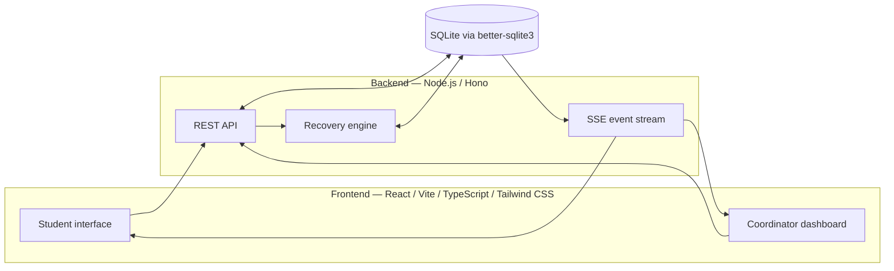

# ROUTELESS — Rural Student Arrival Assurance Network

> **Aerophilia 2K26 · Prompt Battle**  
> *When the bus fails, the journey shouldn't end.*

<<<<<<< HEAD
**ROUTELESS** is a mobile-first transport recovery and coordination platform for rural students and educational institutions. When a bus is missing, delayed, overcrowded, or disrupted, students can report the issue and request assistance. School transport coordinators can verify incidents, assess verified alternative transport capacity, review a deterministic recovery plan, and approve feasible assignments without double-booking seats.
=======
A mobile-first arrival recovery platform helping students and school transport coordinators respond to missing, delayed, full, or disrupted buses using verified backup transport capacity and transparent seat allocation.
>>>>>>> 6c60b77df5698475ec4067769b5fe8236b660d5f

ROUTELESS focuses on **what happens when a journey fails**—not just how to find a bus.

<<<<<<< HEAD
> **Project status:** This README documents the architecture, API endpoints, and demonstration scenario supplied by the project team. It does not assert that a particular hosted deployment, live GPS feed, or external school integration has been independently verified. Demonstration scenarios should be clearly identified as simulated.

## Contents
=======
## 🏗️ Architecture

| Layer | Stack |
|---|---|
| **Backend** | Node.js · Hono · SQLite (`better-sqlite3`) · Server-Sent Events (SSE) · Docker |
| **Frontend** | React 18 · Vite · TypeScript · Tailwind CSS · Three.js (3D route scene) |
| **AI Feature** | Sarvam AI Indic Language API — Kannada natural-language triage |
| **Deployment** | Frontend → Vercel · Backend → Railway / Docker |
>>>>>>> 6c60b77df5698475ec4067769b5fe8236b660d5f

- [The problem](#the-problem)
- [What ROUTELESS does](#what-routeless-does)
- [Architecture](#architecture)
- [Technology stack](#technology-stack)
- [Getting started](#getting-started)
- [Backend API](#backend-api)
- [Demonstration walkthrough](#demonstration-walkthrough)
- [Recovery and safety guarantees](#recovery-and-safety-guarantees)
- [Real-time updates](#real-time-updates)
- [Testing](#testing)
- [Limitations and future work](#limitations-and-future-work)
- [Submission checklist](#submission-checklist)

<<<<<<< HEAD
## The problem

In rural areas, many students rely on a small number of public buses to reach school or college. If a bus breaks down, does not arrive, is full, or cannot use a road, students may have no practical way to coordinate a safe alternative. Institutions may also lack a consolidated view of affected students and spare capacity in verified vehicles.

The problem is therefore more than route discovery: it is **transport disruption recovery under limited capacity**.

## What ROUTELESS does

### For students

- View transport and disruption information made available to the application.
- Report a missing, delayed, full, or disrupted bus.
- Create a request for transport assistance.
- View request and confirmed-assignment status.
- Escalate an unserved request for school assistance.

### For coordinators

- View reported and confirmed incidents.
- Confirm or dismiss incident reports.
- Review vehicle inventory, routes, blocked corridors, and available capacity.
- Correct transport status or seat information.
- Run a deterministic recovery analysis.
- Review proposed placements and approve a plan after capacity and eligibility are revalidated.
- Monitor derived dashboard metrics and receive server-sent updates.

### Core workflow



**Important:** A proposed assignment does **not** reserve a seat. A seat is committed only when the approval transaction succeeds.

## Architecture



The backend exposes REST endpoints for state-changing operations and **Server-Sent Events (SSE)** for pushing updates to connected clients. SQLite stores the application state, and recovery-plan approval uses a transaction to re-check constraints before assignments are confirmed.

### Repository layout

```text
ROUTELESS/
├── backend/             # Hono API, recovery logic, SQLite persistence
├── frontend/            # React + Vite + TypeScript user interface
├── docker-compose.yml   # Docker Compose entry point
└── README.md
```

This illustrates the expected top-level layout from the provided run commands; individual source filenames may differ.

## Technology stack

| Layer | Technology | Purpose |
| --- | --- | --- |
| Frontend | React, Vite, TypeScript | Mobile-first student and coordinator interface |
| Styling | Tailwind CSS | Responsive UI |
| Backend | Node.js, Hono | API and business logic |
| Database | SQLite with `better-sqlite3` | Persistent application state and atomic approval |
| Live updates | Server-Sent Events (SSE) | Push incident, assignment, and dashboard changes |
| Containers | Docker / Docker Compose | Container-based local execution |

## Getting started

### Prerequisites

- Node.js and npm compatible with the project dependencies.
- Docker and Docker Compose **only** if using the container workflow.
- If `better-sqlite3` needs compilation, the platform's native build toolchain.

### Option A — Run backend and frontend separately

**Terminal 1 — Backend**

=======
## 🚀 Quickstart (Local)

### Prerequisites
- Docker Desktop running
- Node.js 20+

### 1. Backend (via Docker — recommended)
>>>>>>> 6c60b77df5698475ec4067769b5fe8236b660d5f
```bash
docker compose up --build
# Backend available at http://localhost:3000
```

<<<<<<< HEAD
**Terminal 2 — Frontend**

=======
### 2. Frontend
>>>>>>> 6c60b77df5698475ec4067769b5fe8236b660d5f
```bash
cd frontend
npm install
npm run dev
# Frontend available at http://localhost:5173
```

<<<<<<< HEAD
The API examples below use `http://localhost:3000`. The Vite terminal will print the frontend development URL. If your ports are configured differently, use the addresses printed by the running services.

### Option B — Docker Compose

From the repository root:

```bash
docker compose up --build
=======
### 3. Environment Files

**`backend/.env`**
```env
PORT=3000
DB_PATH=./data/routeless.db
SARVAM_API_KEY=your_sarvam_key_here
FRONTEND_URL=*
```

**`frontend/.env`**
```env
VITE_API_URL=http://localhost:3000
>>>>>>> 6c60b77df5698475ec4067769b5fe8236b660d5f
```

Stop containers with `Ctrl+C` or, if running detached, `docker compose down`.

### Health check

<<<<<<< HEAD
```bash
curl http://localhost:3000/health
```

A successful response indicates the backend is reachable. The exact response body depends on the implementation.

## Backend API

The following routes are based on the provided backend contract.

| Method | Endpoint | Description |
| --- | --- | --- |
| `GET` | `/health` | Backend liveness check |
| `GET` | `/api/villages` | Villages and corridor IDs |
=======
| Method | Path | Purpose |
|---|---|---|
| `GET` | `/health` | Liveness check |
| `GET` | `/api/villages` | Villages + corridor IDs |
>>>>>>> 6c60b77df5698475ec4067769b5fe8236b660d5f
| `GET` | `/api/transport` | Vehicle inventory, routes, blocked corridors |
| `PATCH` | `/api/transport/:id` | Coordinator correction of seat counts or vehicle status |
| `GET` | `/api/incidents` | Reported and confirmed disruptions |
| `POST` | `/api/incidents` | Submit an incident report |
| `PATCH` | `/api/incidents/:id` | Confirm or dismiss an incident |
| `GET` | `/api/requests` | Assistance requests and confirmed assignments |
| `POST` | `/api/requests` | Create a help request |
<<<<<<< HEAD
| `PATCH` | `/api/requests/:id/escalate` | Escalate for institutional assistance |
| `POST` | `/api/recovery/run` | Generate a deterministic draft plan, without holding seats |
| `POST` | `/api/recovery/approve` | Atomically validate and confirm proposed assignments |
| `GET` | `/api/metrics` | Derived dashboard metrics |
| `GET` | `/api/events` | SSE stream of application updates |
| `GET` | `/api/scenarios` | Available demonstration scenarios |
| `POST` | `/api/scenarios/reset/:id` | Transactionally reset to a selected demo scenario |

> **Authorization:** These endpoint descriptions do not by themselves establish production authentication or role enforcement. Verify and secure access before deploying the application with real student, driver, or institutional data.

## Demonstration walkthrough

### Scenario: Village C — Bus B2 breakdown

The configured showcase uses **12 affected students** in Village C. A verified backup van, **V1**, has **8 seats available** for the disrupted journey.

Expected outcome: **8 proposed assignments, 4 unserved requests**.

#### 1. Confirm the disruption
=======
| `PATCH` | `/api/requests/:id/escalate` | Request school assistance |
| `POST` | `/api/recovery/run` | Deterministic draft plan (seats NOT held) |
| `POST` | `/api/recovery/approve` | Atomic capacity re-check + confirm assignments |
| `GET` | `/api/metrics` | Derived dashboard metrics |
| `GET` | `/api/events` | SSE stream for live coordinator→student push |
| `GET` | `/api/scenarios` | Demo scenario presets |
| `POST` | `/api/scenarios/reset/:id` | Reset demo state to a scenario |
| `POST` | `/api/triage/sarvam` | Kannada text → structured incident (Sarvam AI) |

---
>>>>>>> 6c60b77df5698475ec4067769b5fe8236b660d5f

## 🎬 Demo Flow

### Default Scenario (Village C / Bus B2 Breakdown)
```bash
<<<<<<< HEAD
=======
# 1. Confirm the reported breakdown
>>>>>>> 6c60b77df5698475ec4067769b5fe8236b660d5f
curl -X PATCH http://localhost:3000/api/incidents/INC-B2-BREAKDOWN \
  -H "Content-Type: application/json" \
  -d '{"status":"confirmed"}'
```

<<<<<<< HEAD
#### 2. Run the recovery analysis

```bash
=======
# 2. Run recovery engine — 12 affected, 8 proposed on Van V1, 4 unserved
>>>>>>> 6c60b77df5698475ec4067769b5fe8236b660d5f
curl -X POST http://localhost:3000/api/recovery/run
```

<<<<<<< HEAD
This generates a **draft plan only**. It does not consume vehicle capacity.

#### 3. Approve the proposed assignments

Save a `plan.json` file containing the intended proposals in the API's request format. For example, each proposal uses the following keys:

```json
{
  "proposals": [
    { "requestId": "REQ-001", "transportOptionId": "VAN-V1" }
  ]
}
```

The snippet shows **one illustrative proposal**, not the complete eight-assignment plan. For the full scenario, include all eight eligible proposals returned by the recovery analysis.

```bash
=======
# 3. Approve the plan (all-or-nothing atomic transaction)
>>>>>>> 6c60b77df5698475ec4067769b5fe8236b660d5f
curl -X POST http://localhost:3000/api/recovery/approve \
  -H "Content-Type: application/json" \
  -d @plan.json
```

<<<<<<< HEAD
Approval performs an atomic re-check of capacity, eligibility, incident status, and duplicate assignments. If any proposed assignment conflicts, the **entire submitted plan is rejected** rather than partially committed.

#### 4. Inspect metrics

```bash
curl http://localhost:3000/api/metrics
```

The supplied scenario describes van V1 reaching **10/10 total seat usage** after approving eight new placements, implying two seats were already occupied before the recovery approval.

#### 5. Explore other scenarios

```bash
curl http://localhost:3000/api/scenarios
```

Use a scenario ID returned by that endpoint:

```bash
curl -X POST http://localhost:3000/api/scenarios/reset/SCENARIO_ID
```

Resetting a scenario changes demonstration data; do not invoke it against data you intend to preserve.

## Recovery and safety guarantees

The backend's described approval flow is designed around these rules:

- **Human verification:** Reported incidents must be confirmed before being treated as verified disruptions.
- **Verified capacity:** Recovery recommendations use eligible transport capacity; unavailable or incompatible options must not be promised to students.
- **Draft versus confirmed:** Running analysis does not hold seats.
- **Atomic approval:** Approval re-checks all relevant constraints in one SQLite transaction.
- **No duplicate booking:** Duplicate or conflicting placements invalidate the submitted plan.
- **Clear unserved outcomes:** Insufficient capacity is represented honestly rather than replaced with a fabricated ride.

These are behavioral requirements described in the supplied API and workflow; confirm them against the repository's automated tests and deployment before treating them as externally verified guarantees.

## Real-time updates

`GET /api/events` provides an **SSE stream** for connected clients to receive application updates without repeated polling. SSE is suitable for live incident, request, allocation, and dashboard state changes.

**SSE does not automatically imply real-time GPS bus tracking.** A road-following map and live bus position require additional route geometry and GPS position data. They should only be described as live features after an actual location source and matching backend contract are implemented.

## Testing

### Backend unit tests

```bash
cd backend
npm test
```

### Node.js 24 / native dependency note

`better-sqlite3` may require native build tools on some Node.js 24 environments. For **database-free unit tests only**, the supplied project instructions allow:
=======
# 4. Check metrics — Van V1 usage goes to 8/8
curl http://localhost:3000/api/metrics
```

### Exam Day Crisis Scenario
```bash
curl -X POST http://localhost:3000/api/scenarios/reset/SCN-EXAM-CRISIS
# Loads: 17 students · dual B1+B2 breakdown · Southern corridor flooded
# Engine: 10 exam students → all 8 Van V1 seats · 9 unserved (honest)
```

### Kannada Triage (Sarvam AI)
```bash
curl -X POST http://localhost:3000/api/triage/sarvam \
  -H "Content-Type: application/json" \
  -d '{"text":"ನಾಳೆ 9 ಗಂಟೆಗೆ ಎಕ್ಸಾಮ್ ಇದೆ, ಬಸ್ ಬಂದಿಲ್ಲ"}'
# → { isExamDay: true, urgency: "critical", incidentType: "no_show" }
```

> **Safety guarantee:** Draft proposals never consume seats. Approval re-checks capacity, incident status, eligibility, and duplicate assignments inside a single SQLite transaction. One conflict rejects the entire plan.

---

## 🧪 Tests
>>>>>>> 6c60b77df5698475ec4067769b5fe8236b660d5f

```bash
cd backend
npm run test
# ✓ 13 tests passing (Vitest)
```

<<<<<<< HEAD
Using `--ignore-scripts` is **not** a complete backend installation if SQLite's native module still needs to be built. For a running backend, use a supported Node version and install/build the native dependency normally.

### Frontend build

```bash
cd frontend
npm run build
```

Run tests and builds locally and record the actual outputs before submission. No test-run results are claimed in this document.

## Limitations and future work

- **Demonstration versus production:** Seeded incidents, seat availability, and school processes are examples, not verified public transport feeds.
- **Real-world onboarding:** Institutions and transport operators must provide accurate vehicle information and authorize actual transport decisions.
- **Authentication and privacy:** Real student or driver data requires secure role-based access, data retention rules, and privacy safeguards.
- **Live bus map:** A route map and moving vehicle marker are a separate frontend feature and require authentic route geometry and location updates before they can be marketed as live tracking.
- **ETA accuracy:** Real-time arrival predictions require reliable vehicle position and routing/traffic assumptions.
- **Offline operation:** Server-side reporting and approval require network connectivity; cached frontend views do not imply successful delivery of reports.

## Submission checklist

- [ ] Backend starts and `/health` responds.
- [ ] Frontend builds and loads without runtime errors.
- [ ] Incident confirmation → recovery run → approval works end-to-end.
- [ ] 12 affected / 8 proposed / 4 unserved scenario is reproducible.
- [ ] Atomic approval, duplicate prevention, and zero-backup cases are tested.
- [ ] Deployment URL works from a fresh browser session.
- [ ] Public GitHub repository contains the source, documentation, and no secrets.
- [ ] Demo data, limitations, and permission boundaries are clearly explained.
- [ ] Prompt archive and actual prompt iterations are included if required for judging.

---

**ROUTELESS · Aerophilia 2K26 Prompt Battle**  
*When the bus fails, the journey shouldn't end.*
=======
---

## 📁 Project Structure

```
routeless-last-mile/
├── backend/
│   ├── src/
│   │   ├── db/            # schema.sql, seed.ts, client.ts
│   │   ├── domain/        # recoveryEngine.ts, eligibility.ts, metrics.ts
│   │   ├── routes/        # incidents, requests, recovery, events, triage, ...
│   │   └── tests/         # engine.test.ts (Vitest)
│   ├── Dockerfile
│   └── package.json
├── frontend/
│   ├── src/
│   │   ├── api/           # client.ts (all backend API calls + field mapping)
│   │   ├── components/    # DemoBadge, AssignmentCard, EmptyState, student/*
│   │   ├── pages/         # StudentHome.tsx, CoordinatorDashboard.tsx
│   │   ├── hooks/         # useSSE.ts
│   │   └── data/          # types.ts
│   └── package.json
├── docker-compose.yml
└── prompts.md             # Prompt Battle trajectory log
```

---

## 🔒 Safety Principles

- **Verified vehicles only** — no unvetted driver matching, no open carpooling
- **Honest unserved state** — never fake 100% success; show real seat math
- **Demo labeled** — `DemoBadge` present on all student-facing screens
- **Config-driven relay routes** — read from `relay_routes` DB table, never hardcoded strings
- **All-or-nothing approval** — one seat conflict rejects the entire plan

---

## 👥 Team — Aerophilia 2K26

Built at **Aerophilia 2K26 Prompt Battle** using Google Antigravity (Gemini) + Claude via Antigravity.
>>>>>>> 6c60b77df5698475ec4067769b5fe8236b660d5f
